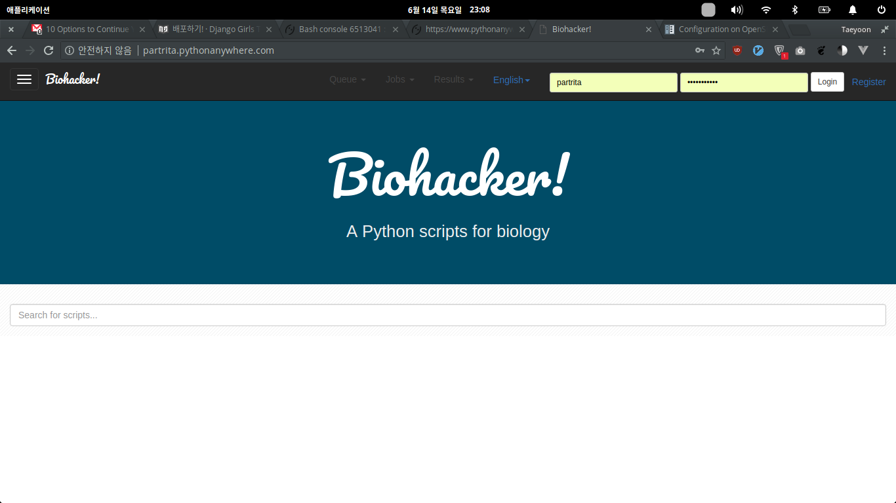

# Wooey for PythonAnywhere

> A web UI for Python scripts

[Wooey](https://github.com/wooey/Wooey) is an easy way to turn Python scripts into web applications for routine data analysis, file processing, or anything else.



> **Note on PythonAnywhere:** PythonAnywhere does **not** support background Celery workers on standard web apps. If you deploy without a separate Celery worker, scripts queued via Celery will not execute unless `WOOEY_CELERY = False` is set in `cuddlymachine/settings/user_settings.py` (which runs scripts synchronously).

## Tech Stack

- **Python**: 3.14+
- **Django**: 5.2+
- **Wooey**: 0.14+
- **Package Manager**: [uv](https://docs.astral.sh/uv/)

---

## Local Development

### 1. Clone and install dependencies

```bash
git clone https://github.com/<your-github-username>/<your-git-repo-name>.git
cd <your-git-repo-name>
uv sync
```

### 2. Initialize database and superuser

```bash
uv run python manage.py migrate
uv run python manage.py createsuperuser
```

### 3. Run the development server

```bash
uv run python manage.py runserver
```

To execute Wooey scripts asynchronously in local development, run a Celery worker in a separate terminal:

```bash
uv run celery -A cuddlymachine.wooey_celery_app worker -l info
```

### 4. Lint & Type Check

```bash
uv run ruff check --fix
uv run ty check
```

---

## Deployment on PythonAnywhere

### 1. Configure `ALLOWED_HOSTS`

In `cuddlymachine/settings/user_settings.py`, ensure your PythonAnywhere domain is included:

```python
ALLOWED_HOSTS = (
    'localhost',
    '127.0.0.1',
    '.pythonanywhere.com',
)
```

### 2. Clone and install dependencies on PythonAnywhere

Open a **Bash console** on PythonAnywhere:

```bash
git clone https://github.com/<your-github-username>/<your-git-repo-name>.git
cd <your-git-repo-name>
curl -LsSf https://astral.sh/uv/install.sh | sh
uv sync
```

### 3. Run migrations, collect static files, and create superuser

```bash
uv run python manage.py migrate
uv run python manage.py collectstatic --noinput
uv run python manage.py createsuperuser
```

### 4. Add a new Web app

1. Go to the PythonAnywhere **Dashboard** -> **Web**.
2. Click **Add a new web app**.
3. Set your domain name and select **Manual configuration**.
4. Choose the latest available **Python** version and complete the wizard.

### 5. Set Virtualenv path

In the **Virtualenv** section, enter the path to the `.venv` created by `uv`:

```text
/home/<your-username>/<your-git-repo-name>/.venv
```

### 6. Configure WSGI file

In the **Code** section, open `/var/www/<your-username>_pythonanywhere_com_wsgi.py`, replace its contents with:

```python
import os
import sys

path = '/home/<your-username>/<your-git-repo-name>'
if path not in sys.path:
    sys.path.append(path)

os.environ['DJANGO_SETTINGS_MODULE'] = 'cuddlymachine.settings'

from django.core.wsgi import get_wsgi_application
from django.contrib.staticfiles.handlers import StaticFilesHandler

application = StaticFilesHandler(get_wsgi_application())
```

### 7. Reload

Click the **Reload** button on the Web tab. If any errors occur, check the **Error log** link in the Log files section.

---

## Meta

Momore hatz – [Blog](https://partrita.github.io)
